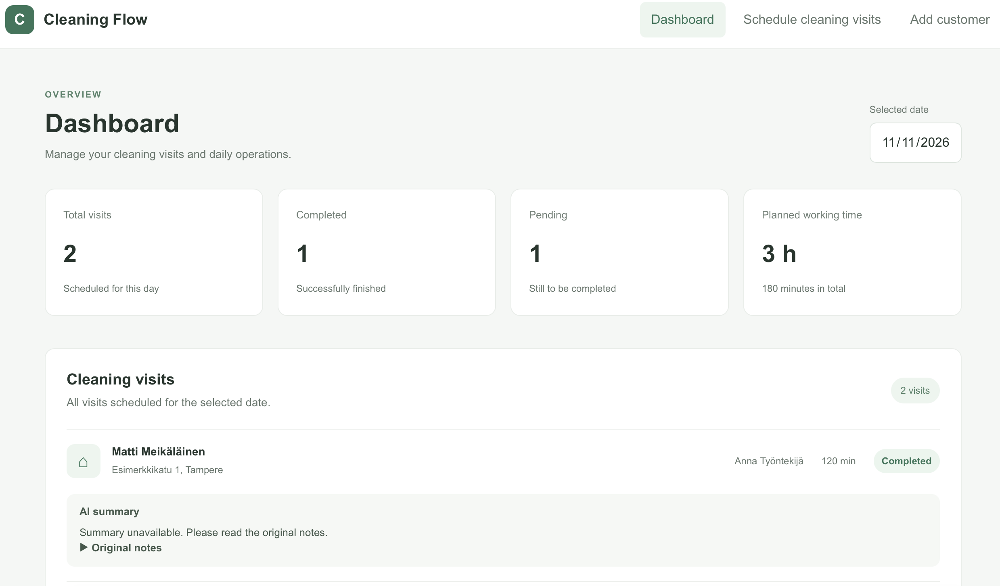
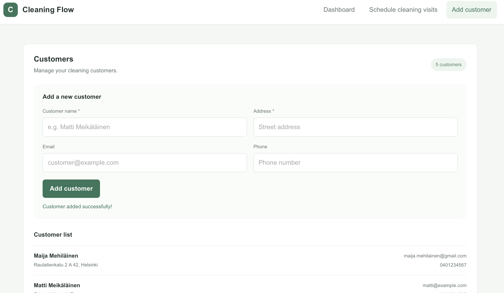
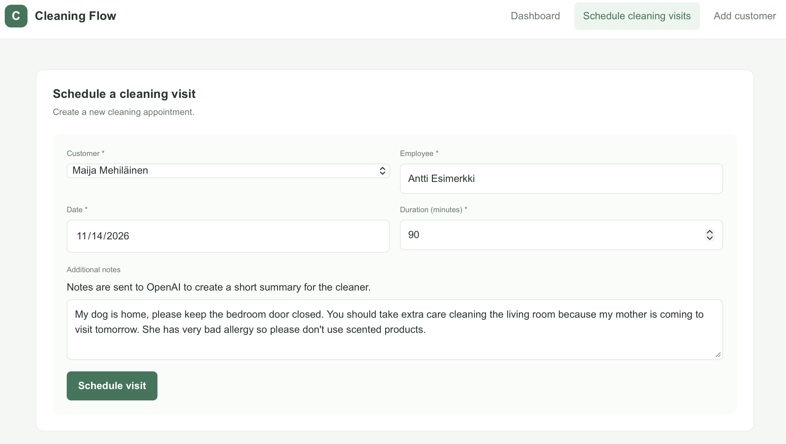
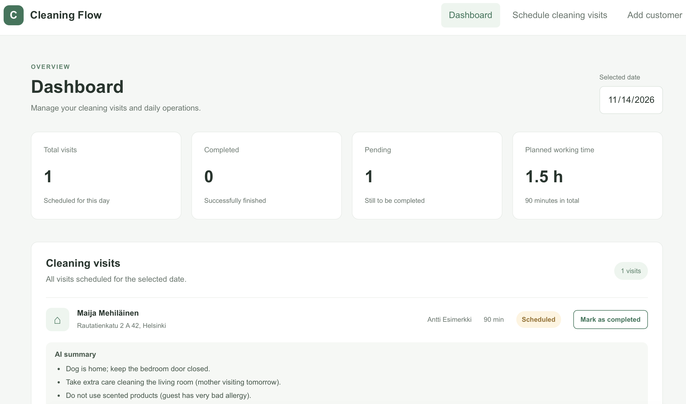

# Cleaning Flow

A full-stack app for managing customers and cleaning visits. Schedule work,
track completed visits, and view daily workload summaries.

## Features

- Add and view customers.
- Schedule visits with an employee, date, duration, and notes.
- View visits by date, mark them completed, and track daily totals and hours.
- Generate optional AI summaries of visit notes while keeping the original notes.

## Screenshots

### Dashboard

View scheduled visits, completion status, and daily workload totals.



### Add a customer

Create a customer before scheduling their cleaning visits.



### Schedule a visit

Assign an employee, choose a date and duration, and add visit notes.



### AI visit summary

AI generates a summary based on the visit notes while keeping the original notes available.



## Tech stack

React, TypeScript, and Vite frontend; Express and SQLite (`better-sqlite3`)
backend. Tests use Vitest, React Testing Library, and Supertest.

## Run locally

Requires Node.js 22.18 or newer. From the project root, install dependencies for
the root tooling, frontend, and backend:

```sh
npm ci
npm --prefix client ci
npm --prefix server ci
```

Start the backend and frontend in separate terminals:

```sh
npm --prefix server run dev
```

```sh
npm --prefix client run dev
```

Open the URL printed by Vite. The API runs at `http://localhost:3000/api`.
SQLite tables are created automatically. The default database is
`Cleaning-flow.db` in the server process's working directory; set `DATABASE_PATH`
to use another location.

To enable AI summaries, copy `server/.env.example` to `server/.env`, set
`OPENAI_API_KEY`, and restart the backend. `OPENAI_MODEL` defaults to
`gpt-6-luna`. Visit notes are sent to OpenAI when summaries are enabled. Keep
the API key on the server and out of Git. The app works without an API key.

## Usage

Add a customer, schedule a visit, select its date on the dashboard, and mark it
completed when finished.

## Development

```sh
npm run check
npm run build
```

These commands run linting, formatting checks, type checks, tests, and builds.
GitHub Actions runs both on pushes and pull requests. See [TESTING.md](TESTING.md)
for details.

## Project structure

- `client/`: React interface and API client.
- `server/`: Express API, SQLite storage, and AI summaries.

The API provides customer and visit management, visit status updates, daily
reports, and a health check at `/api/health`.

## Current limitations

- No authentication or user roles; API endpoints are accessible without signing in.
- Customers and visits cannot be edited or deleted. Visits only support status
  updates after creation, so dates, employee assignments, and notes cannot be changed.
- Scheduling records a date and duration, without start times, employee
  availability, or conflict detection. Employee names are entered as free text.
- The frontend API URL is hardcoded to `http://localhost:3000/api`; deployment
  to another host requires changing it.
